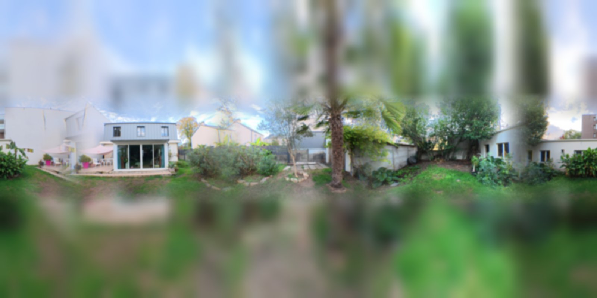

# i2hdri_4Input_QwenImage2512_Qwen25VL_v07

**En une phrase** : environment map extérieure 360° (équirectangulaire 4096 × 2048, PNG 16 bits + EXR 32 bits float) à partir de 4 photos d'un lieu (N / E / S / O) — ou d'une photo Nord et de directions décrites en texte — **sans aucun bloc d'image source visible** : les photos sont réinterprétées.

## Changements v07

- **Passe 2 Affinage désactivable, OFF par défaut** (**🎛️ Passe 2 Affinage**) : en mode Lightning, elle lissait le résultat réaliste de la passe 1 en rendu « dessin ». OFF = la passe 1 part directement au raccord puis à l'upscale (la passe 2 n'est pas calculée).
- **🎛️ Mode QUALITÉ** (OFF par défaut) : sans LoRA Lightning, **30 steps**, **CFG 3**, prompt négatif anti-illustration actif (*illustration, cartoon, 3d render, flat colors…*). Plus réaliste et plus détaillé, environ 4 à 6 fois plus long. Réglages : 🎛️ Steps mode QUALITÉ (25–40), 🎛️ CFG mode QUALITÉ (2.5–4). S'applique aux passes 1, 2 et au raccord.
- **🎛️ Grain de l'esquisse** par défaut à **0.08** (passe 1 moins bruitée).
- Aperçu **👁️ Sortie génération** : montre la passe 1 ou la passe 2 selon l'interrupteur.

## Rappel v05

- **Fin du rendu en aplats / « illustration »** : en v04, la passe 1 était déjà simplifiée (aperçu 👁️ Passe 1). Cause : esquisse très lisse (fond 64 × 32) + 4 steps seulement en img2img → l'IA conserve le lissé. Corrections :
  - **Grain** ajouté à l'esquisse (`ImageAddNoise`, 0.1) et grain léger avant l'affinage (0.04) : de la matière que l'IA transforme en herbe, crépi, feuillage.
  - **Steps 8** (≈ 6 steps utiles à Liberté IA 0.8, contre ≈ 3 avant).
  - Fond un peu moins lissé : **128 × 64**.
  - **Affinage 0.3**.
  - Consignes 360 : *sharp photographic detail, natural textures…, not an illustration, not a 3D render*.

## Rappel v04

- **Lien plus fort avec les photos** : en plus du fond flou, chaque photo est posée **nette, à son échelle réelle, sur l'horizon** (bande 640 × 384 ≈ 112° de champ, fondue sur ses 4 bords). L'IA voit les vrais éléments (bâtiments, arbres, clôtures) au niveau du regard, au lieu de taches de couleur.
- **Fond réduit à des dégradés** (64 × 32 puis flou) : il ne donne plus que les couleurs du ciel et du sol, sans doublon des éléments de la bande.
- Valeurs par défaut plus fidèles : **Liberté IA 0.8**, **Affinage 0.25**.
- Rappel v03 : aucun pixel n'est protégé, toute la sphère est repeinte → pas de bloc.

## Pipeline

1. **Analyse** — Qwen2.5-VL-7B (pack ComfyUI-QwenVL, FP16) décrit chaque photo (≈ 80 mots, EN). Slot OFF → texte saisi. Exécution *lazy*.
2. **Prompt** — trigger LoRA 360 + description globale + « Looking north / east / south / west: … » + consignes 360.
3. **Fond** — Nord étiré sur 2048 × 1024 ; chaque photo étirée en colonne 640 × 1024, fondue avec ses voisines ; réduction 128 × 64 → agrandissement → flou : couleurs du ciel et du sol.
4. **Bandes nettes** — chaque photo recadrée 640 × 384 (≈ 112°), posée sur l'horizon (y = 320), fondue 128 px côtés / 96 px haut-bas, léger flou (rayon 4), puis **grain** 0.1.
5. **Passe 1 — Repeint 360°** — Qwen-Image-2512 + LoRA Lightning + LoRA *qwen-360-diffusion*, img2img sur toute l'image, denoise **Liberté IA**.
6. **Passe 2 — Affinage** (optionnelle, OFF par défaut) — grain 0.04 puis denoise 0.25–0.4.
7. **Raccord gauche / droite** (option) — décalage 180°, bande de 256 px repeinte, remise en place.
8. **Upscale** ×4 RealESRGAN → 4096 × 2048 → `Save Image (Advanced)` PNG 16 bits + EXR 32 bits float.

*Simulation sur les photos de test (jardin, DJI Osmo Action 4) : l'esquisse qui entre dans la passe 1 — bandes nettes sur l'horizon, fond en dégradés.*

## Modèles requis

| Type | Nom exact | Source |
|---|---|---|
| Diffusion | `qwen_image_2512_fp8_e4m3fn.safetensors` | [Comfy-Org/Qwen-Image_ComfyUI](https://huggingface.co/Comfy-Org/Qwen-Image_ComfyUI) |
| LoRA | `Qwen-Image-2512-Lightning-4steps-V1.0-fp32.safetensors` | [lightx2v/Qwen-Image-Lightning](https://huggingface.co/lightx2v/Qwen-Image-Lightning) |
| LoRA | `qwen-360-diffusion-2512-int8-bf16-v2.safetensors` | identique à `qwen_environnement_4vues_360_cloud_v3` (Comfy Cloud) |
| Text encoder | `qwen_2.5_vl_7b_fp8_scaled.safetensors` | [Comfy-Org/Qwen-Image_ComfyUI](https://huggingface.co/Comfy-Org/Qwen-Image_ComfyUI) |
| VAE | `qwen_image_vae.safetensors` | [Comfy-Org/Qwen-Image_ComfyUI](https://huggingface.co/Comfy-Org/Qwen-Image_ComfyUI) |
| Upscale | `RealESRGAN_x4plus.pth` (ou `4x-UltraSharp.pth`) | upscale_models Comfy Cloud |
| VLM | `Qwen2.5-VL-7B-Instruct` → `models/LLM/Qwen-VL/` | téléchargé auto par ComfyUI-QwenVL |

## Nodes custom

- **ComfyUI-QwenVL** (1038lab) — `AILab_QwenVL`, description des photos. Préinstallé sur Comfy Cloud.
- Tout le reste est natif : `ImageScale`, `FeatherMask`, `ImageCompositeMasked`, `ComfySwitchNode`, `StringConcatenate`, `ImageStitch`, `PreviewAny`, `SaveImageAdvanced`…

## Réglages clés

| Paramètre | Valeur | Pourquoi |
|---|---|---|
| Liberté IA (passe 1) | **0.8** (0.7–0.9) | < 0.75 : la bande nette et le fond flou restent visibles ; > 0.85 : lieu moins reconnaissable |
| Adoucit les bandes | rayon 4, sigma 2 | 0 = plus fidèle mais transition bande / fond plus marquée ; 8–12 = plus libre |
| Taille des bandes | 640 × 384 | calibrée pour ≈ 110–120° de champ horizontal (action cam, ultra grand-angle) |
| Affinage (passe 2) | 0.3 (0.25–0.4) | netteté et texture sans dériver |
| 🎛️ Grain de l'esquisse | 0.08 (0.05–0.15) | < 0.06 : aplats ; > 0.15 : bruit visible dans le résultat |
| Steps / CFG (rapide) | **8** / 1.0, euler / simple | LoRA Lightning ; négatif sans effet à CFG 1 |
| Steps / CFG (🎛️ Mode QUALITÉ) | **30** / **3.0**, euler / simple | modèle complet sans Lightning ; négatif actif ; 4–6× plus long |
| 🎛️ Passe 2 Affinage | **OFF** | en Lightning, lisse vers un rendu dessiné ; à tester en mode QUALITÉ |
| ModelSamplingAuraFlow | 3.1 | valeur validée sur le WF 360 v3 |
| Génération | 2048 × 1024 | taille native du LoRA 360 ; 4K par upscale |
| Raccord (bande) | 0.6, 256 px | fond le bord gauche/droite |
| Qwen2.5-VL | `None (FP16)`, 192 tokens | seule quantization acceptée sur Comfy Cloud ; si OOM : keep loaded OFF ou 3B |
| EXR | 32-bit float, input `sRGB` | conversion sRGB → linéaire Rec.709 par le nœud |

## Entrées attendues

- 4 photos prises **du même point**, à hauteur d'homme, en tournant **vers la droite** : N, puis E, S, O. Horizon vers le milieu de l'image. Tout format (étirées dans leur colonne).
- Photos de test du jardin : dans [images/](images/) — `in_nord.JPG`, `in_est.JPG`, `in_sud.JPG`, `in_ouest.JPG` (DJI Osmo Action 4). Les RAW `.DNG` restent en local : exclus du dépôt par le `.gitignore`.
- Slot en OFF : son *Load Image* doit quand même contenir une image valide (ignorée).

## Prompt Set

Coller [CONTEXT_prompt-set_i2hdri_4Input_QwenImage2512_Qwen25VL_v07.md](CONTEXT_prompt-set_i2hdri_4Input_QwenImage2512_Qwen25VL_v07.md) dans une conversation Claude, puis donner le brief et joindre les photos. Claude renvoie les champs à coller.

## Exemples

| Entrée | Résultat |
|---|---|
|  | *(à ajouter : `images/out_pano.png`)* |

## Limites connues

- **Réinterprétation** : plus proche des photos qu'en v03, mais pas reproduit au pixel.
- **Photos plus serrées** (≈ 70–80° de champ) : les éléments sont posés trop grands ; utiliser le mode grand-angle de l'appareil.
- **Zénith / nadir** : seulement des dégradés de couleur dans l'esquisse, entièrement inventés. Pour un assemblage fidèle de vraies photos : logiciel de stitching (Hugin, PTGui), prises sur pied en tournant autour du point nodal, ≥ 30 % de recouvrement. Un test d'assemblage géométrique automatique sur les photos de test (main levée, jardin étroit → forte parallaxe) n'a donné que 2 à 39 correspondances fiables par paire : inexploitable.
- **Pas un vrai HDRI** : génération LDR. L'EXR est linéaire mais le soleil ne dépasse pas 1 : monter *Strength* du World ou ajouter une *Sun lamp*.
- Zénith et nadir souvent flous ou étirés.
- Orientation Blender : centre de l'image (Nord) vers −Y sans rotation ; tourner en Z via *Mapping*.
- `Save Image (Advanced)` : au chargement, vérifier les menus *format* / *bit_depth*.
- Licence Qwen : vérifier avant usage commercial.
