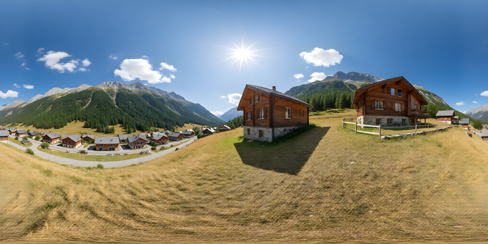
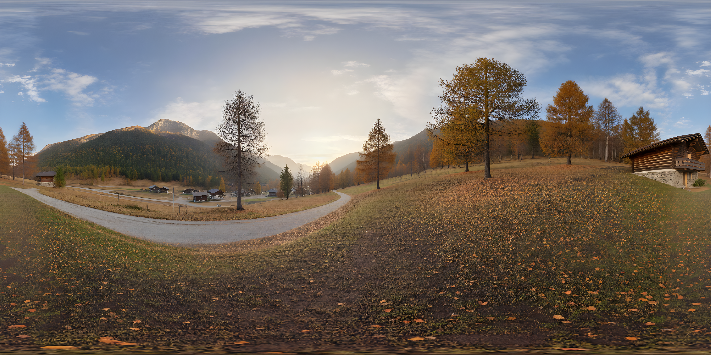

# t2hdri_Sliders_QwenImage2512_Qwen360LoRA_v01

**En une phrase** : environment map extérieure 360° (équirectangulaire 4096 × 2048, PNG 16 bits + EXR 32 bits float) **à partir d'un prompt texte** et de quatre barrettes verrouillées — **heure de la journée** (hauteur du soleil), **saison** (végétation, sol, lumière), **nuages** (densité pondérée par la saison) et **hauteur de prise de vue** (1,80 m / 30 m / 100 m). 100 % nœuds natifs, Comfy Cloud.

Dérivé de `i2hdri_4Input_QwenImage2512_Qwen25VL_v07` : même stack de génération et même chaîne raccord → upscale → sauvegarde, mais **sans photos, sans Qwen2.5-VL, sans esquisse et sans passe 2** (elle lissait le résultat vers un rendu dessiné).

## Pipeline

1. **Presets verrouillés** — chaque barrette est un `PrimitiveInt` ; `Math Expression` (natif) calcule la position dans une table à largeur fixe (`PrimitiveStringMultiline`), `Substring` lit la ligne, `Trim` retire le remplissage. Les index sont bornés dans l'expression (une valeur hors plage prend la borne). Table nuages = 4 saisons × 5 niveaux = 20 lignes, index = saison × 5 + nuages.
2. **Prompt** — trigger LoRA 360 + ✏️ prompt de base + « Time of day: … » + « Season: … » + « Sky: … » + « Camera height: … » + consignes 360 fixes (`StringConcatenate`, le libellé est dans le *delimiter*). Preset ➕ *Rendu photo pro* bypassé par défaut. **👁️ Prompt assemblé** affiche le texte final.
3. **Génération** — `EmptySD3LatentImage` 2048 × 1024, KSampler denoise 1.0, Qwen-Image-2512 + LoRA Lightning + LoRA *qwen-360-diffusion* (ou mode QUALITÉ sans Lightning).
4. **Raccord gauche / droite** (option, ON) — décalage 180°, bande de 256 px repeinte avec le même prompt, remise en place.
5. **Upscale** ×4 RealESRGAN → 4096 × 2048 exact → `Save Image (Advanced)` PNG 16 bits + EXR 32 bits float.

## Barrettes (prompts pré-enregistrés, EN)

| Barrette | Valeurs | Ce que le preset décrit |
|---|---|---|
| 🎛️ Heure (0–7) | 0 nuit · 1 aube · 2 lever du soleil · 3 matin · 4 midi · 5 après-midi · 6 golden hour · 7 crépuscule | **hauteur** du soleil, longueur des ombres, couleur de la lumière. Pas de point cardinal : testé, le LoRA 360 place le soleil près du centre du pano quoi qu'on lui demande — on oriente dans Blender |
| 🎛️ Saison (0–3) | 0 printemps · 1 été · 2 automne · 3 hiver | feuillage, herbe, état du sol (boue, poussière, feuilles mortes, givre / neige), qualité de l'air et de la lumière |
| 🎛️ Hauteur de prise de vue (0–2) | 0 hauteur d'homme (1,80 m) · 1 ≈ 30 m (toit, drone bas) · 2 ≈ 100 m (drone haut) | distance au sol, échelle des objets, perspective aérienne ; l'horizon reste au milieu de l'image (équirectangulaire). La mention « eye level » a été retirée des consignes fixes pour ne pas contredire le preset |
| 🎛️ Nuages (0–4) | 0 dégagé · 1 quelques nuages · 2 épars · 3 chargé · 4 couvert | type de nuages **selon la saison** (cumulus d'été, cirrus d'automne, stratus bas d'hiver…), soleil visible ou caché, lumière dure ou diffuse |

Les tables sont dans le groupe *PRESETS VERROUILLÉS*. Ne pas les éditer à la main : chaque ligne a la même largeur (remplissage par des espaces) et une ligne modifiée décale les suivantes. Pour changer un texte, modifier les tables dans `build_t2hdri.py` (dans ce dossier) et relancer `python build_t2hdri.py ../t2hdri_Sliders_QwenImage2512_Qwen360LoRA_v01.json`.

## Modèles requis

| Type | Nom exact | Source |
|---|---|---|
| Diffusion | `qwen_image_2512_fp8_e4m3fn.safetensors` | [Comfy-Org/Qwen-Image_ComfyUI](https://huggingface.co/Comfy-Org/Qwen-Image_ComfyUI) |
| LoRA | `Qwen-Image-2512-Lightning-4steps-V1.0-fp32.safetensors` | [lightx2v/Qwen-Image-Lightning](https://huggingface.co/lightx2v/Qwen-Image-Lightning) |
| LoRA | `qwen-360-diffusion-2512-int8-bf16-v2.safetensors` | identique à `i2hdri_…_v07` (Comfy Cloud) |
| Text encoder | `qwen_2.5_vl_7b_fp8_scaled.safetensors` | [Comfy-Org/Qwen-Image_ComfyUI](https://huggingface.co/Comfy-Org/Qwen-Image_ComfyUI) |
| VAE | `qwen_image_vae.safetensors` | [Comfy-Org/Qwen-Image_ComfyUI](https://huggingface.co/Comfy-Org/Qwen-Image_ComfyUI) |
| Upscale | `RealESRGAN_x4plus.pth` (ou `4x-UltraSharp.pth`) | upscale_models Comfy Cloud |

## Nodes custom

- Aucun — 100 % natifs : `PrimitiveInt/Float/Boolean/StringMultiline`, `ComfyMathExpression`, `StringSubstring`, `StringTrim`, `StringConcatenate`, `ComfySwitchNode`, `EmptySD3LatentImage`, `KSampler`, `ImageStitch`, `ImageCompositeMasked`, `SaveImageAdvanced`, `PreviewAny`…
- `ComfyMathExpression` (« Math Expression ») est récent dans le core : si le nœud apparaît en rouge sur Cloud, mettre l'instance à jour.

## Réglages clés

| Paramètre | Valeur | Pourquoi |
|---|---|---|
| Génération | 2048 × 1024, denoise 1.0 | taille native du LoRA 360 ; 4K par upscale |
| Steps / CFG (rapide) | **8** / 1.0, euler / simple | LoRA Lightning ; négatif sans effet à CFG 1, éviter les négations dans le prompt |
| Steps / CFG (🎛️ Mode QUALITÉ) | **30** / **3.0** | modèle complet sans Lightning ; négatif anti-illustration actif ; 4–6× plus long |
| 🎛️ Raccord | ON, 0.6 (0.5–0.7), 256 px | fond le bord gauche/droite ; monter si un élément fort traverse le Sud |
| ModelSamplingAuraFlow | 3.1 | valeur validée sur les WF 360 précédents |
| ➕ Rendu photo pro | bypassé | Ctrl+B pour un rendu plus neutre / architectural |
| EXR | 32-bit float, input `sRGB` | conversion sRGB → linéaire Rec.709 par le nœud |

## Entrées attendues

- **✏️ Prompt de base (EN)** : uniquement type d'environnement / style, lieu et éléments marquants, type de boîtier. Pas d'heure, de saison ni de météo (les barrettes l'emportent).
- Quatre entiers : Heure, Saison, Nuages, Hauteur de prise de vue.

## Géolocalisation

Il n'existe pas de nœud natif Cloud pour calculer la position du soleil depuis lat/long/date/heure, et le LoRA 360 ne place pas le soleil au degré près. La géoloc se fait donc **dans le prompt set** : Claude calcule azimut / élévation et biome pour « lieu + date + heure », choisit la barrette Heure et les types de végétation, et renvoie les valeurs pour l'add-on Blender *Sun Position* (soleil exact combiné au HDRI). Le soleil étant toujours généré au centre, l'hémisphère ne change rien : seule la rotation Z dans Blender compte.

## Prompt Set

Coller [CONTEXT_prompt-set_t2hdri_Sliders_QwenImage2512_Qwen360LoRA_v01.md](CONTEXT_prompt-set_t2hdri_Sliders_QwenImage2512_Qwen360LoRA_v01.md) dans une conversation Claude, puis donner le brief. Claude renvoie le prompt de base et les valeurs des barrettes.

## Exemples

| Entrée | Résultat |
|---|---|
| Prompt par défaut (alpage alpin), Heure 4 · Saison 1 · Nuages 1 |  |
| Même prompt, Heure 5 · Saison 2 · Nuages 2 |  |

## Limites connues

- **Pas un vrai HDRI** : génération LDR, l'EXR est linéaire mais le soleil ne dépasse pas 1 : monter *Strength* du World ou ajouter une *Sun lamp*.
- **Soleil au centre du pano** quelle que soit la barrette Heure (test : midi et après-midi → soleil au centre, ombres cohérentes). Orienter le HDRI en Z (Mapping) dans Blender, ou le combiner avec *Sun Position* pour un soleil exact.
- Nuit (Heure 0) : le LoRA 360 est surtout entraîné sur du jour ; résultat variable, préférer 1 ou 7.
- Zénith et nadir souvent flous ou étirés.
- **Hauteur 30 m / 100 m** : le LoRA 360 est surtout entraîné au niveau du sol ; les vues aériennes sont plus variables (nadir parfois incohérent, échelle approximative). Changer de seed, ou passer en mode QUALITÉ.
- Orientation Blender : centre de l'image (Nord) vers −Y sans rotation.
- `Save Image (Advanced)` : au chargement, vérifier les menus *format* / *bit_depth*.
- Licence Qwen : vérifier avant usage commercial.
